# GitPersona

**English** | [简体中文](README.zh-CN.md)

[](https://github.com/weikxs/gitpersona/actions/workflows/ci.yml)
[](https://github.com/weikxs/gitpersona/releases)
[](go.mod)
[](LICENSE)
[](#supported-systems)
[](#the-web-console)

**Git profiles that follow your directories.**

Work in `~/Projects/acme` and you commit, push and open pull requests as your work account.
Switch to `~/Projects/personal` and you are your personal account again. No commands to run, nothing to remember,
and a check that proves no repository commits or pushes as the wrong account.

<picture>
  <source media="(prefers-color-scheme: dark)" srcset="docs/images/terminal-dark.png">
  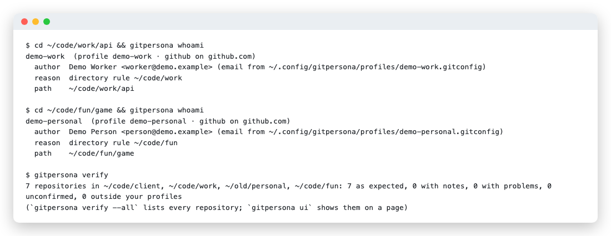
</picture>

> **Status: first release (0.1).** Everything below works and is tested on macOS and Linux: GitHub, GitLab, Bitbucket
> and other-host profiles, the command line, the web console in English and Chinese, shell integration and `gh` /
> `glab` switching. Windows is planned. Feedback and issues are welcome.

## Contents

- [Get started in 3 steps](#get-started-in-3-steps)
- [The web console](#the-web-console)
- [The command line](#the-command-line)
- [Why](#why)
- [Features](#features)
- [How it works](#how-it-works)
- [Supported systems](#supported-systems)
- [Install](#install)
- [Quick start](#quick-start)
- [Configuration reference](#configuration-reference)
- [Commands](#commands)
- [How it behaves](#how-it-behaves)
- [Undo and uninstall](#undo-and-uninstall)
- [Troubleshooting](#troubleshooting)
- [FAQ](#faq)
- [Contributing](#contributing) · [Security](#security) · [License](#license)

## Get started in 3 steps

**1. Install** (macOS on Apple silicon or Intel, and Linux):

```sh
brew install weikxs/tap/gitpersona                              # Homebrew, macOS and Linux
go install github.com/weikxs/gitpersona/cmd/gitpersona@latest   # or with Go 1.26+
```

**2. Set up in your browser.** Sign in to each GitHub account once with `gh auth login`, then:

```sh
gitpersona setup --web
```

GitPersona finds your accounts, your existing `includeIf` identities, SSH aliases and repositories, and shows one
complete proposal. Nothing is written until you click **Apply**, and every file is backed up first. Prefer the
terminal? `gitpersona setup` shows the same proposal there and asks once.

<picture>
  <source media="(prefers-color-scheme: dark)" srcset="docs/images/setup-en-dark.png">
  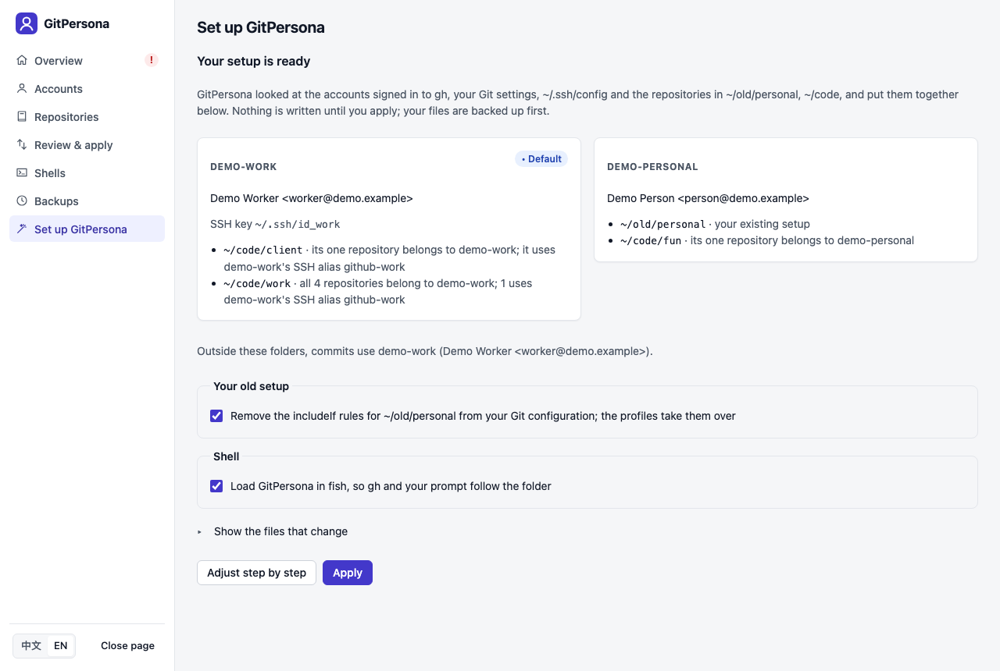
</picture>

**3. Check every repository.** `gitpersona verify` (or **Repositories** in `gitpersona ui`) lists, per repository,
the author its commits use and the account each remote pushes as, and flags anything that would use another
identity. Add `--ssh` and each SSH host names the account a key signs in as.

**Day to day there is nothing to do:** `cd` into a project and use `git`, `gh` or your IDE as usual.
`gitpersona whoami` tells you who you are in the current folder; `gitpersona use <profile>` gives a new folder to a
profile; `gitpersona pin <profile>` handles the odd repository that lives elsewhere.

## The web console

`gitpersona ui` opens a local console in your browser (only on 127.0.0.1; the link works once, and it stops after
15 minutes without use). Everything the command line does is there, in English and Chinese: the page starts in your
system's language, else your browser's, else English, and the switch in the sidebar changes it for the tab.

**Overview:** the numbers that matter (accounts, repositories, identity mix-ups, notes, health), what needs attention
first, and every account with the folders each of its identities covers.

<picture>
  <source media="(prefers-color-scheme: dark)" srcset="docs/images/overview-en-dark.png">
  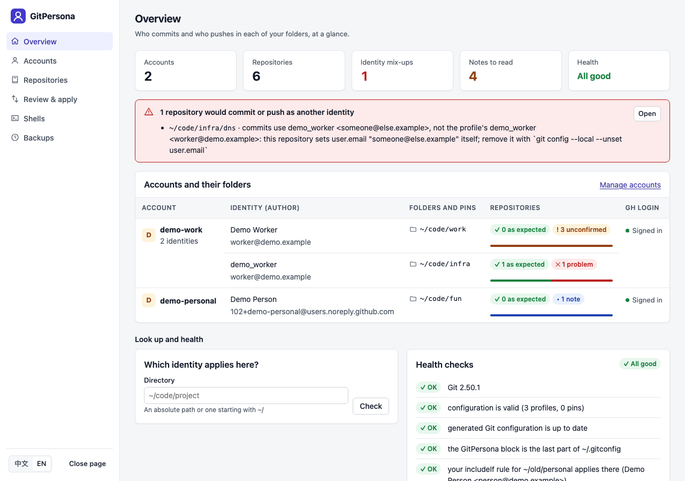
</picture>

**Accounts:** one card per account. An account that commits under two author names has two identities under it,
each with its own folders and pinned repositories; folders and pins are added and removed in place.

<picture>
  <source media="(prefers-color-scheme: dark)" srcset="docs/images/accounts-en-dark.png">
  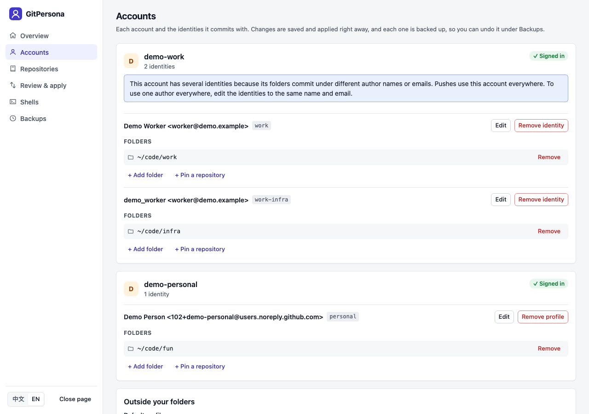
</picture>

**Repositories:** who commits and who pushes in every repository, grouped by account, with filters and the reason for
every note or problem.

<picture>
  <source media="(prefers-color-scheme: dark)" srcset="docs/images/repositories-en-dark.png">
  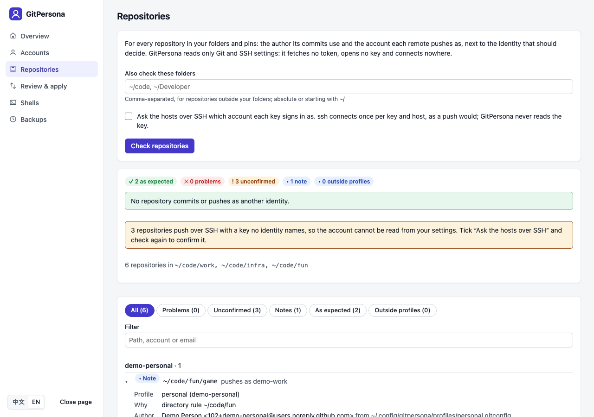
</picture>

**Review & apply:** every file a change would write, as a diff, before anything is written.

<picture>
  <source media="(prefers-color-scheme: dark)" srcset="docs/images/apply-en-dark.png">
  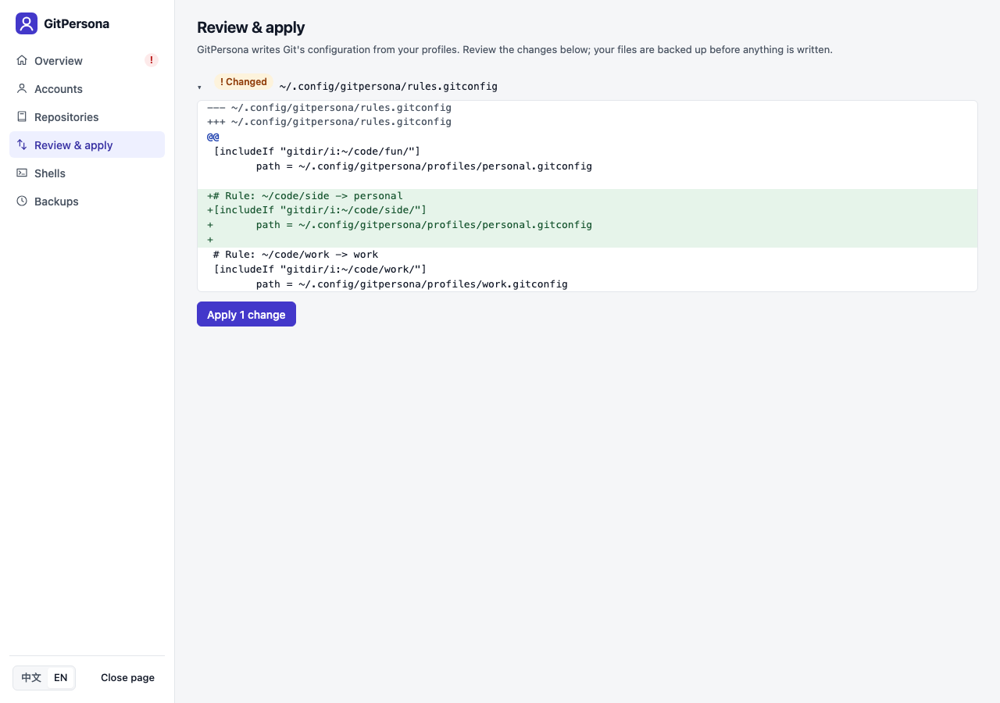
</picture>

<details>
<summary><b>More pages:</b> health checks, shells, backups</summary>

**Health checks** (at the end of the overview): the same checks as `gitpersona doctor`, each with what to do.

<picture>
  <source media="(prefers-color-scheme: dark)" srcset="docs/images/health-en-dark.png">
  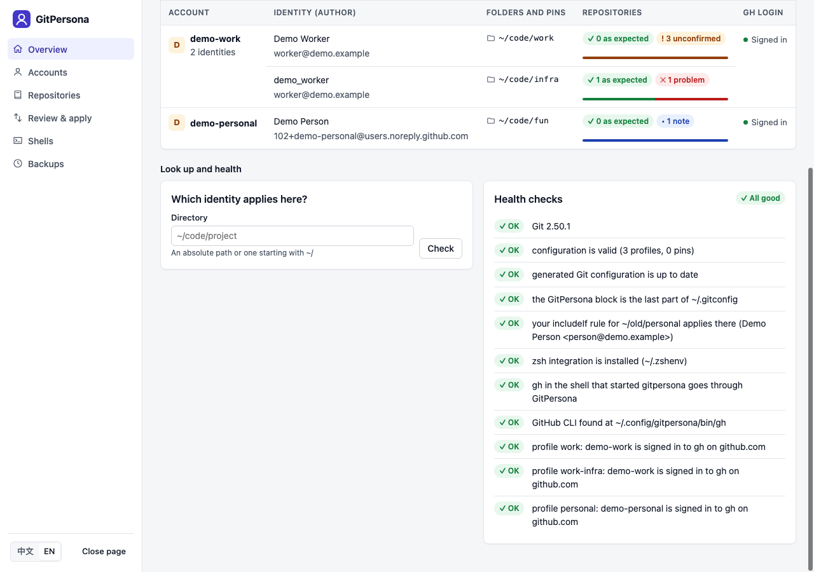
</picture>

**Shells:** your login shell, the shell running now, and which installed shells load GitPersona.

<picture>
  <source media="(prefers-color-scheme: dark)" srcset="docs/images/shells-en-dark.png">
  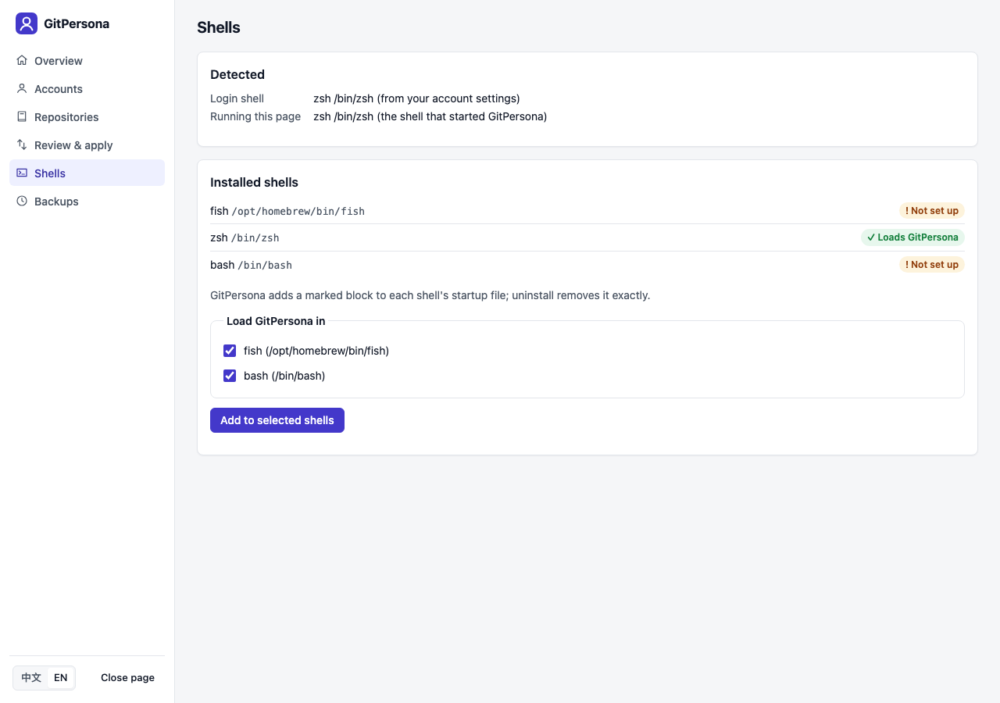
</picture>

**Backups:** every change is backed up first; restore any of them (the current state is backed up too).

<picture>
  <source media="(prefers-color-scheme: dark)" srcset="docs/images/backups-en-dark.png">
  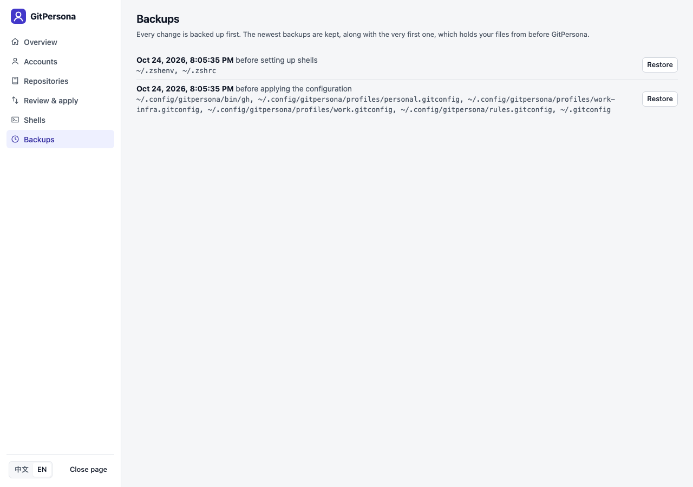
</picture>

</details>

The console works on a phone-sized screen and follows the system's dark theme. The pictures in this README are
drawn by `make screenshots` from a demo home with made-up accounts.

## The command line

Everything the console shows is also on the command line, for scripts and for people who live in the terminal.

**`gitpersona setup`** looks at what you already have and proposes a complete setup; nothing is written until you
say yes.

<picture>
  <source media="(prefers-color-scheme: dark)" srcset="docs/images/terminal-setup-dark.png">
  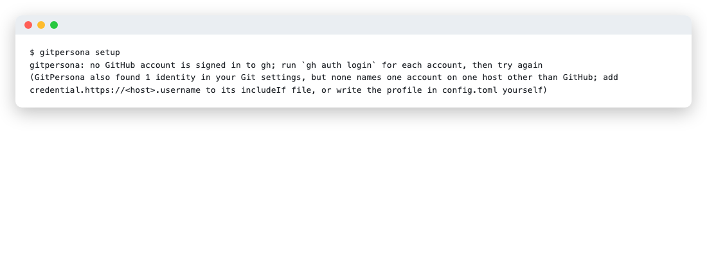
</picture>

**`gitpersona verify`** names, for every repository, the author and the push account, and says why anything is off
and how to fix it. It exits with an error when a repository would commit or push as another identity, so it fits in
scripts and CI.

<picture>
  <source media="(prefers-color-scheme: dark)" srcset="docs/images/terminal-verify-dark.png">
  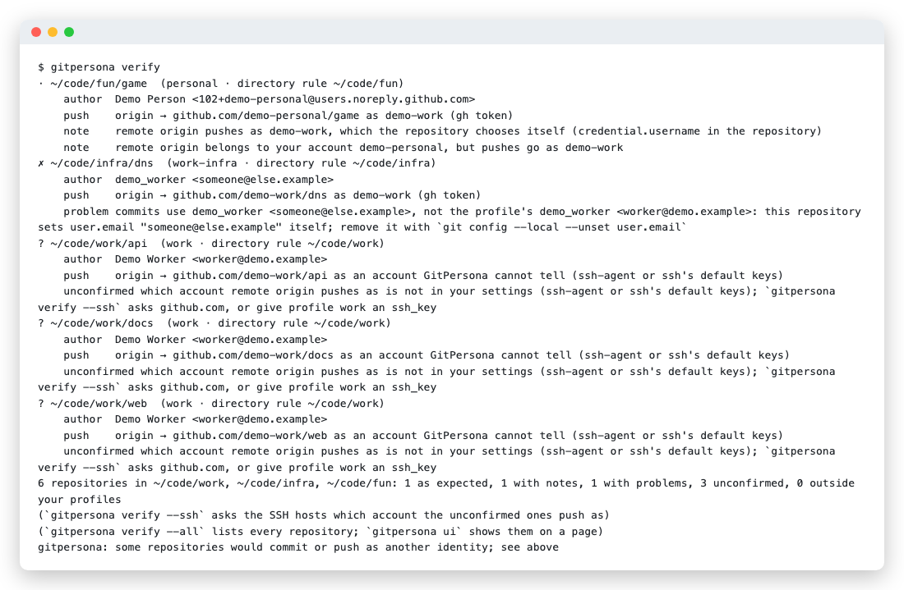
</picture>

**`gitpersona doctor`** checks the whole setup, from the Git version to each account's `gh` sign-in.

<picture>
  <source media="(prefers-color-scheme: dark)" srcset="docs/images/terminal-doctor-dark.png">
  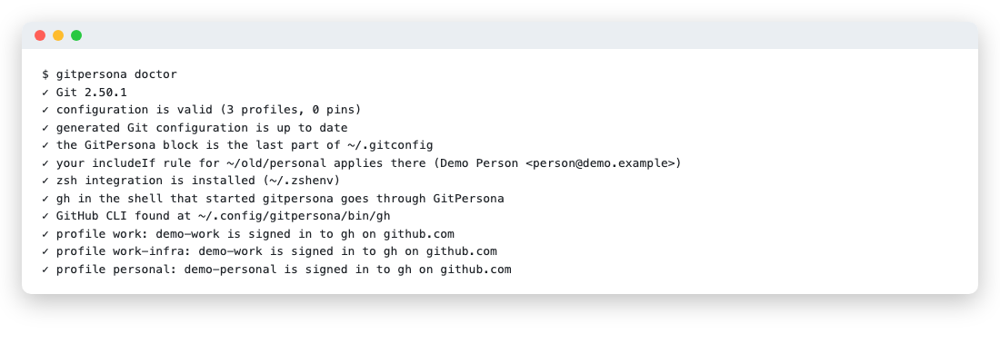
</picture>

## Why

Many developers use several Git accounts on one machine: personal, work, and client accounts.
Git, `gh` and `glab` each assume one global "current account", so it is easy to commit with the wrong email,
push with the wrong token, or open a pull request as the wrong user.

## Features

- **One directory, one identity.** Bind directories to a profile; every repository inside follows it.
- **One rule set for everything:** commit author and email, HTTPS credentials, SSH key, commit signing,
  and the `gh` / `glab` account.
- **Several accounts per host.** Two GitHub accounts, three GitLab accounts on a company server: each directory
  pushes with its own account's token.
- **Proof, not hope.** `gitpersona verify` checks every repository's author and push account against its profile,
  catches tokens written in remote URLs and SSH connections shared between keys, and can ask each SSH host which
  account a key really signs in as.
- **Works everywhere:** fish, zsh and bash, IDEs and GUI Git clients, scripts and non-interactive shells.
  It uses Git's own `includeIf` instead of rewriting your global config.
- **Never stores tokens, never reads keys.** Credentials stay in `gh`, the system keychain (or Git Credential
  Manager) and ssh-agent. Private key files are only checked to exist.
- **Set up in a minute.** `gitpersona setup` finds the accounts you are signed in to, your existing `includeIf`
  identities, SSH aliases and repositories, and proposes a complete configuration; you confirm once.
- **A web console in English and Chinese** for everything: overview, accounts, repositories, review, shells, backups.
- **Repo pins** for the odd repository that lives outside its usual directory.
- **Safe to try.** Every change is backed up; `rollback` and `uninstall` put your files back exactly.

```text
~/Projects/personal/**       → octo-alex    (personal, GitHub)
~/Projects/acme/**           → acme-alex    (work, GitHub)
~/Projects/clients/globex/** → globex-alex  (client, self-hosted GitLab)
everything else              → acme-alex    (default)
```

## How it works

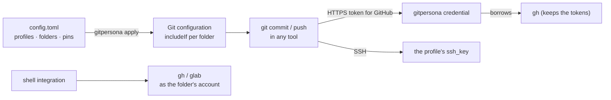

The files involved:

```text
~/.config/gitpersona/config.toml        your profiles, directories and pins (you edit this, or let setup/ui do it)
            │  gitpersona apply
            ▼
~/.gitconfig                            one marked block, last in the file, that includes ↓
~/.config/gitpersona/rules.gitconfig    includeIf "gitdir:<dir>/" → profiles/<id>.gitconfig, most specific last
~/.config/gitpersona/profiles/*.gitconfig
                                        user.name / user.email, credential username, core.sshCommand, signing
```

Git itself picks the profile from the repository's location, so it works in every tool that runs Git. For GitHub,
Git asks `gitpersona credential` for a token, which borrows the one `gh` already keeps for that account. For other
hosts the profile only names the account, and your own credential helper answers with that account's token.
With the shell integration, `gh` and `glab` follow the same rules.

## Supported systems

| System | CPU | Status |
|---|---|---|
| macOS 12 Monterey or newer | Apple silicon (M1 and later) | Supported, tested on every change |
| macOS 12 Monterey or newer | Intel | Supported, tested on every change |
| Linux: Debian, Ubuntu, Fedora, Arch, Alpine and others (glibc or musl) | x86_64, arm64 | Supported, tested on every change |
| Windows | — | Planned |

The tests run on Apple silicon and Intel Macs, on Linux x86_64 and arm64, and in Debian, Alpine, Fedora and
Ubuntu 22.04 containers (Ubuntu 22.04 has the oldest Git the tests use, 2.34).

**Requirements**

- Git 2.31 or newer. Git 2.36 or newer if you have your own `includeIf "hasconfig:remote.*.url:…"` rules: older
  Git ignores them, and `gitpersona doctor` says so.
- For GitHub profiles: the [GitHub CLI](https://cli.github.com) 2.40 or newer, signed in to each account
- For GitLab, Bitbucket and other hosts: a credential helper that keeps tokens per account, such as the system
  keychain (`osxkeychain` on macOS, `libsecret` on Linux) or [Git Credential Manager](https://github.com/git-ecosystem/git-credential-manager);
  `gitpersona doctor` names one that is installed
- Optional: [`glab`](https://gitlab.com/gitlab-org/cli) for GitLab, fish, zsh or bash for the shell integration

## Install

**With Go** (1.26 or newer):

```sh
go install github.com/weikxs/gitpersona/cmd/gitpersona@latest
```

**From source:**

```sh
git clone https://github.com/weikxs/gitpersona.git
cd gitpersona
make build
./bin/gitpersona version   # then put bin/gitpersona on your PATH
```

**Homebrew** (macOS and Linux):

```sh
brew install weikxs/tap/gitpersona
```

The binary is not signed by Apple yet, so on macOS the cask removes the quarantine flag from it after installing;
see [SECURITY.md](SECURITY.md). Homebrew picks the build for your Mac (Apple silicon or Intel) by itself.

**Linux packages** from the [releases page](https://github.com/weikxs/gitpersona/releases),
for x86_64 (`amd64`) and arm64:

```sh
sudo apt install ./gitpersona_<version>_linux_amd64.deb        # Debian, Ubuntu
sudo dnf install ./gitpersona_<version>_linux_amd64.rpm        # Fedora, RHEL
sudo apk add --allow-untrusted ./gitpersona_<version>_linux_amd64.apk   # Alpine
sudo pacman -U ./gitpersona_<version>_linux_amd64.pkg.tar.zst  # Arch
```

Archives (`.tar.gz`) for every system are there too, with `checksums.txt` to check them.

## Quick start

### GitHub accounts

1. Sign in to every GitHub account with the GitHub CLI: `gh auth login` (once per account).
2. Run `gitpersona setup` (or `gitpersona setup --web` for the same in your browser). It looks at what you already
   have and puts it together in one step:
   - one profile per account `gh` is signed in to, with its public name and email (or its noreply address);
   - your existing `includeIf` identities, with their SSH keys and signing, which the profiles take over (rules that
     also set other things, such as `url.*.insteadOf`, stay);
   - directories from the remotes and emails of the repositories in your usual code folders (`~/code`, `~/Projects`, …);
   - SSH host aliases from `~/.ssh/config`, such as `git@github-work:…`, and their keys (key files are never opened);
   - pins for repositories that differ from their folder, and the integration for your login shell.

   It shows the result and asks once; everything is backed up first. Folders that belong to an organization it
   cannot attribute are listed for you to choose. In the browser, "Adjust step by step" changes anything before applying.
3. Run `gitpersona doctor`. In any repository, `gitpersona whoami` shows who you are and why.

### GitLab, Bitbucket and other hosts

`gitpersona setup` also turns your existing GitLab, Bitbucket or company-server identities into profiles, even
without `gh`: those whose `includeIf` file names the account (`credential.https://<host>.username`), or whose
repositories all push to one such host as one user. Or add a profile by hand (see below). Then save each account's
token once, in your own credential store:

```sh
git config --global credential.helper osxkeychain   # if you have no helper yet (libsecret on Linux)
gitpersona auth login --profile globex               # paste a personal access token; input is hidden
gitpersona auth status                                # which profiles have a token
```

Pushes from that profile's directories now use that account, and so does `glab`.

### Writing the configuration yourself

`~/.config/gitpersona/config.toml`:

```toml
version = 1
default = "acme"            # used everywhere no rule matches (optional)

[[profile]]
id      = "personal"
account = "octo-alex"       # your account on the host
name    = "Alex Octo"       # commit author name
email   = "1000001+octo-alex@users.noreply.github.com"
dirs    = ["~/Projects/personal"]
signing = { method = "ssh", key = "~/.ssh/id_personal.pub" }

[[profile]]
id      = "acme"
account = "acme-alex"
name    = "Alex (Acme)"
email   = "1000002+acme-alex@users.noreply.github.com"
dirs    = ["~/Projects/acme"]
ssh_key = "~/.ssh/id_acme"

[[profile]]
id       = "globex"
provider = "gitlab"
host     = "gitlab.globex.example"
account  = "globex-alex"
name     = "Alex"
email    = "alex@globex.example"
dirs     = ["~/Projects/clients/globex"]

[[pin]]
repo    = "~/Downloads/globex-hotfix"
profile = "globex"
```

Then run `gitpersona apply` and `gitpersona doctor`. `gitpersona ui` opens the same configuration in your browser.

## Configuration reference

| Key | Required | Meaning |
|---|---|---|
| `version` | yes | Always `1` |
| `default` | no | Profile id used where no rule or pin matches |
| `shell_integration` | no | `false` records that you do not want GitPersona in your shells, so `doctor` does not suggest it (`setup --no-shell` writes it) |
| `[[profile]] id` | yes | Short name: lowercase letters, digits, `-` |
| `provider` | no | `github` (default), `gitlab`, `bitbucket` or `generic`; tokens for the last three live in your own credential store, one per account (`gitpersona auth login`) |
| `host` | no | Defaults to `github.com` for GitHub; required for the other providers (a port is allowed, such as `git.example.com:8443`) |
| `account`, `name`, `email` | yes | Account on the host, commit author name and email |
| `dirs` | no | Directories whose repositories use this profile; the most specific directory wins |
| `ssh_key` | no | Path of the SSH private key Git should use for this profile (only checked to exist, never read) |
| `signing` | no | `{ method = "ssh", key = "~/.ssh/key.pub" }`, `{ method = "gpg", key = "<key id>" }`, or `{ method = "none" }` |
| `[[pin]] repo`, `profile` | — | Bind one repository to a profile, overriding directory rules |

Paths must be absolute or start with `~/`.

## Commands

| Command | What it does |
|---|---|
| `gitpersona setup [--yes] [--no-shell] [--keep-old-rules] [--default <profile> \| --no-default] [--print \| --web]` | Set GitPersona up from what you already have in one step (accounts, existing identities, repositories, SSH aliases, shell); asks before writing unless `--yes`; `--web` shows it in the browser, where you can also adjust it step by step |
| `gitpersona ui [--no-open]` | Open the web console in your browser, in English or Chinese: an overview, accounts with their identities, folders and pins, the repository check, a diff preview before applying, health checks, shells and backups. It listens only on 127.0.0.1, the link works once, and it stops after 15 minutes without use |
| `gitpersona apply [--dry-run] [--yes]` | Generate the Git configuration; `--dry-run` previews, `--yes` allows removing files of deleted profiles |
| `gitpersona whoami [--json] [--check]` | Show which profile Git uses here and why; `--check` fails when Git disagrees |
| `gitpersona verify [--all] [--ssh] [--json] [<folder>...]` | Check every repository in your profiles' folders and pins (and the folders you name): the author its commits use and the account each remote pushes as, against its profile; flags another identity, tokens in remote URLs and SSH connections shared between keys. It reads only settings; `--ssh` signs in to each SSH host once, as a push would, so the host names the account |
| `gitpersona use <profile>` | Make the current directory use a profile (keeps your comments in config.toml) |
| `gitpersona remove [dir]` | Stop assigning a directory to a profile |
| `gitpersona pin <profile>` / `unpin` | Bind the current repository to a profile, or remove the pin |
| `gitpersona list [--json]` | List profiles, directories and pins |
| `gitpersona doctor [--fix] [--json]` | Check the setup and explain how to fix problems; `--fix` repairs what it safely can |
| `gitpersona auth login\|logout\|status [--profile <id>]` | Save, remove or check the token of a GitLab, Bitbucket or other profile in your own credential store (the system keychain or Git Credential Manager), one per account; `status` fails when a token is missing |
| `gitpersona check-ssh [--profile <id>]` | Connect to each profile's host with its SSH key and report which account the host says it is; runs only when you ask, and GitPersona never opens the key (ssh uses it) |
| `gitpersona shells [--json]` | Show your default shell, the shell you use right now, and installed shells |
| `gitpersona install-shell [--shell fish,zsh,bash]` | Add prompt display (and gh / glab switching) to your shells; defaults to your login shell |
| `gitpersona prompt [--format]` | Print the account Git uses here, for prompts (`{account}`, `{profile}`, `{host}`) |
| `gitpersona rollback [<name>\|latest] [--yes]` | List backups, or restore one (the current state is backed up first) |
| `gitpersona uninstall [--yes]` | Remove GitPersona from your Git configuration and put back the `includeIf` rules it took over; keeps config.toml |
| `gitpersona help <command>` | Show the flags of a command |

Prompt and plugin-manager setups (tide, Powerlevel10k, Starship, fisher, oh-my-zsh): see [docs/integrations.md](docs/integrations.md).

## How it behaves

- **Precedence:** a pin, then the most specific directory rule, then `default`. Git applies the rules by the
  location of the repository's `.git` directory, so a **worktree follows its main repository**. Outside any
  repository only `default` applies; `whoami` also tells you which profile new clones will get.
- **Your own `includeIf` rules:** GitPersona's rules come after yours, so in the directories you give to profiles
  (and in pins) the profile decides; everywhere else your own rules work exactly as before. A default profile applies
  everywhere, so while you keep identity rules of your own, `setup` proposes none (`--default <profile>` sets one
  anyway, and says which of your rules it overrides). Rules that do more than a profile can — x509 signing, an SSH
  command with a port or proxy, a key used only for tags, with or without an identity — keep their folders, and so do
  the folders around them. A rule that never applies today (a later rule or global identity of yours overrides it,
  in the order Git reads `~/.config/git/config`, `~/.gitconfig` and the files they include) is not protected.
  Profiles reset signing and the SSH command only where another identity's key could otherwise reach them. A
  repository of another signed-in account is pinned to it, so it pushes with that account. `setup` removes the
  rules a profile fully takes over; `uninstall` puts them back before the section (or rule) that followed them.
  `doctor` says which of your rules a profile overrides.
- **Credentials:** for GitHub profiles, GitPersona is the only credential helper for that host and borrows the
  token `gh` already holds, so no other helper stores a copy. If an account is not signed in to `gh`, Git asks
  for a password; `gitpersona doctor` tells you which account to sign in. For GitLab, Bitbucket and other hosts, your
  own credential helper (the system keychain, Git Credential Manager) keeps one token per account and host, as `gh`
  does for GitHub: `gitpersona auth login` saves it there (hidden input; never a file in clear text), and each
  profile only names its account, so the right token answers. GitPersona keeps no copy. Set the helper for the whole
  host (or globally): Git uses a helper set for `https://<user>@host` only for remotes whose URL names that user. Leave
  `credential.useHttpPath` off for these hosts: with it, helpers keep a token per repository, not per account.
- **gh and glab follow your directories too:** with the shell integration, running `gh` in a profile's directory
  uses that profile's account. GitPersona puts the account's token only into the environment of that one `gh`
  process; it is not printed or stored. It leaves `gh` alone when you set `GH_TOKEN`/`GITHUB_TOKEN`, use `GH_HOST`
  for another host, or no GitHub profile applies. `glab` works the same way: in a GitLab profile's directory it runs
  with that account's token from your credential store (`GITLAB_TOKEN`, only for that process), unless you set a
  token or another host yourself.
- **SSH:** a profile with `ssh_key` makes Git connect with that key in the profile's repositories
  (`ssh -i <key> -o IdentitiesOnly=yes -o ControlPath=none`): only that key is offered, and a shared connection
  (`ControlMaster` in `~/.ssh/config`) opened with another key is never reused, because it would push as that key's
  account. `gitpersona verify` warns when a shared connection could still mix accounts for repositories without a
  profile key. `gitpersona check-ssh` and `gitpersona verify --ssh` connect once per key, only when you run them, and
  report which account the host greets; nothing else ever starts ssh.
- **Shells:** your default shell is read from the system user record (not `$SHELL`, which terminals, IDEs and
  tools often change), the shell you use right now from the process tree, and installed shells from `/etc/shells`.
  fish gets its own file in `conf.d`; zsh uses `~/.zshenv`; bash uses `~/.bashrc`. In tide add the
  `gitpersona` item; in Powerlevel10k add the `gitpersona` segment; elsewhere call `gitpersona_prompt`.
- **Privacy:** GitPersona never opens, reads, lists or uses your private keys, and never prints or stores tokens.
  Its only network use is asking `gh` for your accounts' public names and emails during setup, and the ssh
  connections `check-ssh` and `verify --ssh` make when you run them. `verify` without `--ssh` reads only Git and SSH
  settings. Paths are shown with `~`, and the web console listens only on 127.0.0.1 behind a one-time link.
- **Your files:** it adds one marked block to your global Git configuration (following a symlinked
  `~/.gitconfig` and `GIT_CONFIG_GLOBAL`), backs up everything it changes, and keeps the newest 20 backups in
  `~/.config/gitpersona/backups/`.

## Undo and uninstall

- `gitpersona rollback` lists backups; `gitpersona rollback latest` undoes the last change. Each command's
  changes are one backup, so a rollback undoes the whole operation.
- `gitpersona uninstall` removes GitPersona's block from your Git configuration and puts back the `includeIf`
  rules setup took over, exactly as they were. `config.toml` stays, so `gitpersona apply` brings everything back.
- To remove everything, run `gitpersona uninstall`, remove the GitPersona lines from your shell startup file
  (`~/.zshenv`, `~/.bashrc`, or `~/.config/fish/conf.d/gitpersona.fish`), then delete `~/.config/gitpersona` and the
  binary.

## Troubleshooting

| Symptom | Cause and fix |
|---|---|
| `doctor`: an account is not signed in to `gh` | Run `gh auth login` for that account (once); GitPersona borrows the token `gh` keeps |
| `verify`: commits use another author | The repository sets `user.name` / `user.email` itself; remove them with `git config --local --unset user.email` (verify prints the exact command) |
| `verify`: a remote pushes as another account | The repository sets `credential.username` itself, or its remote URL names a user; remove the setting, or `gitpersona pin` the repository to the profile it belongs to |
| `verify`: a token is written in a remote URL | Anyone who can read `.git/config` can use it. Set the URL without it: `git remote set-url origin https://github.com/<owner>/<repo>.git`, then revoke the token |
| `verify`: SSH pushes are "unconfirmed" | The key ssh offers is not named in your settings (ssh-agent or a default key). Give the profile an `ssh_key`, or run `gitpersona verify --ssh` to ask the host |
| `verify`: an SSH connection is shared between keys | `ControlMaster` in `~/.ssh/config` reuses a connection opened with another key. Profiles with `ssh_key` already skip it; for others set `ControlPath none` for that host |
| `doctor`: an `includeIf "hasconfig:…"` rule never applies | Your Git is older than 2.36 and ignores such rules; update Git |
| `gh` uses the wrong account in a terminal | The shell integration is missing or another directory comes before it on `PATH`: run `gitpersona install-shell`, then open a new terminal |
| Git asks for a password on a GitLab or other host | No token for that account yet: `gitpersona auth login --profile <id>` |
| macOS says the binary cannot be checked | It is not signed by Apple yet; Homebrew removes the quarantine flag. For a downloaded archive: `xattr -d com.apple.quarantine gitpersona` |

`gitpersona doctor --json` and `gitpersona verify --json` give the same results for scripts.

## FAQ

**Does it change my existing Git setup?** Only the marked block it adds. Your own `includeIf` rules keep working
outside the directories you give to profiles; `setup` shows everything it would change and asks first, and every
change is backed up.

**Does it work in my IDE or GUI client?** Yes. The rules are plain Git configuration, so every program that runs Git
follows them. Only `gh` / `glab` switching needs the shell integration.

**Where are my tokens?** GitHub tokens stay in `gh`; other hosts' tokens stay in your credential store. GitPersona
keeps no copy and never prints them.

**Why does `doctor` warn about my credential helper?** For GitLab, Bitbucket and other hosts the helper must keep one
token per account: `store` writes tokens to a file in clear text, `cache` forgets them, and `credential.useHttpPath`
keeps one per repository. `doctor` says what to change.

**Which languages does it speak?** The web console is in English and Simplified Chinese: it starts in your system's
language, else your browser's, else English. The command line is in English.

**Does it support Windows?** Not yet; macOS (Apple silicon and Intel) and Linux are supported and tested on every
change, and Windows is planned.

**What about worktrees and submodules?** A worktree follows its main repository, and a submodule follows the
repository it belongs to, because Git matches rules by where the `.git` directory lives.

## Contributing

Contributions are welcome. Please read [CONTRIBUTING.md](CONTRIBUTING.md) and the
[development standards](docs/development/standards.md) first.

```sh
make check         # formatting, vet, the privacy check and all tests (coverage at least 95%)
make lint          # golangci-lint
make e2e           # the web console in headless Chrome
make screenshots   # redraw the pictures in docs/images from a demo home
```

What changed in each version is in [CHANGELOG.md](CHANGELOG.md); the design notes are in [docs/prd](docs/prd/README.md).

## Security

Please report vulnerabilities privately; see [SECURITY.md](SECURITY.md).

## License

[MIT](LICENSE)
