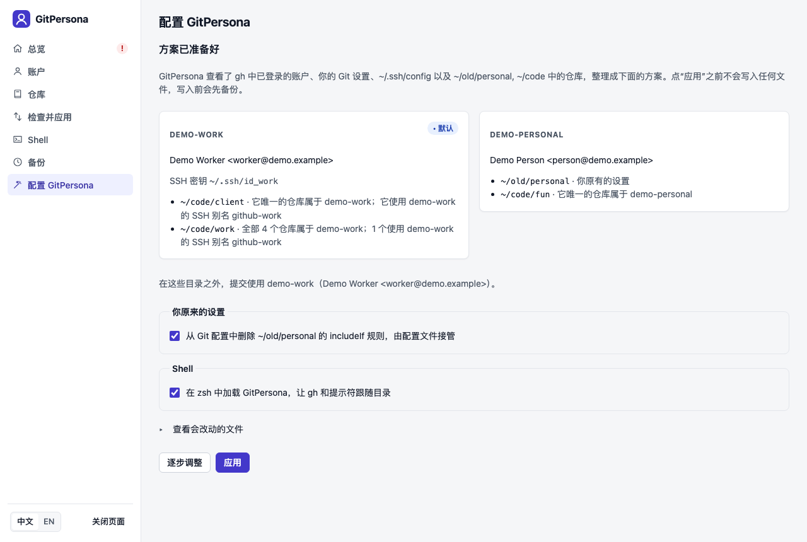
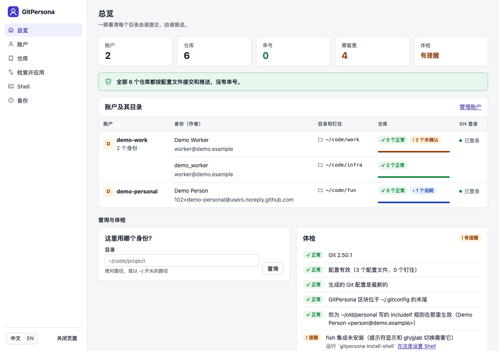
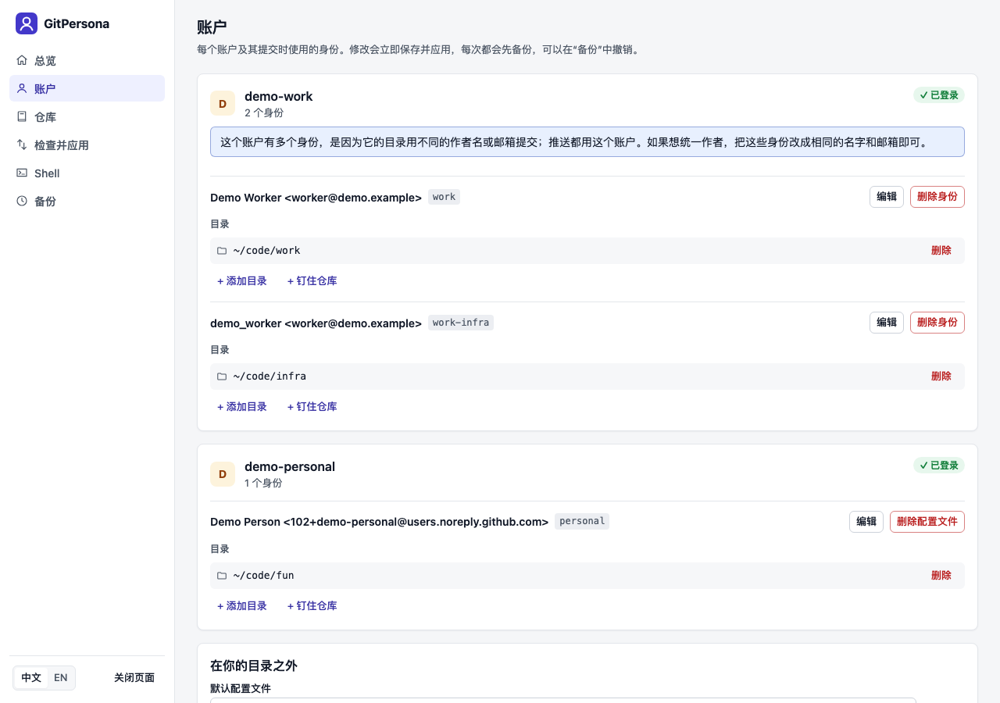
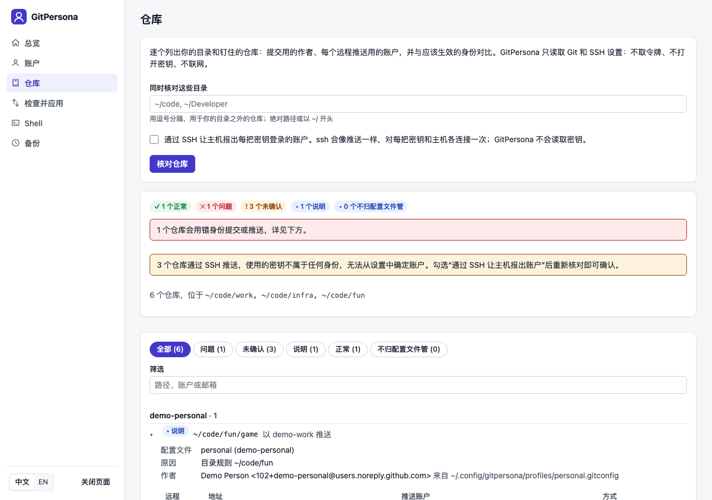
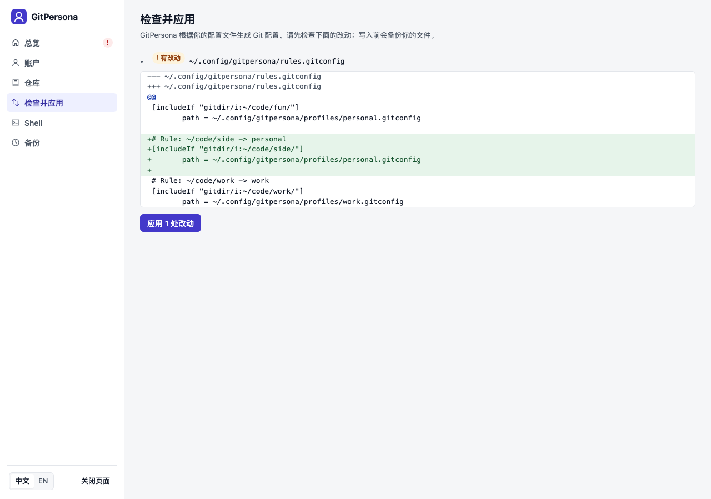
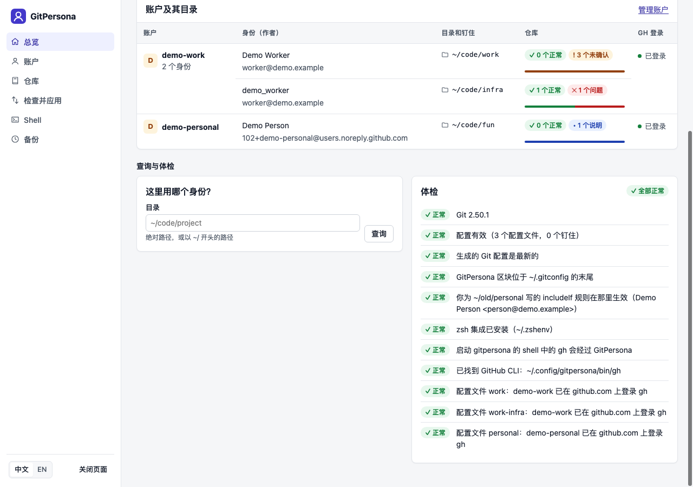
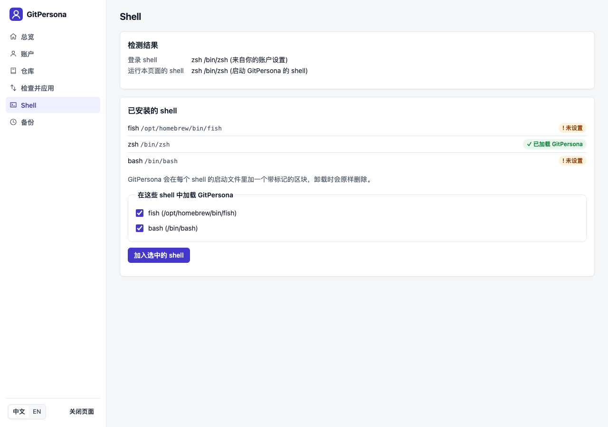
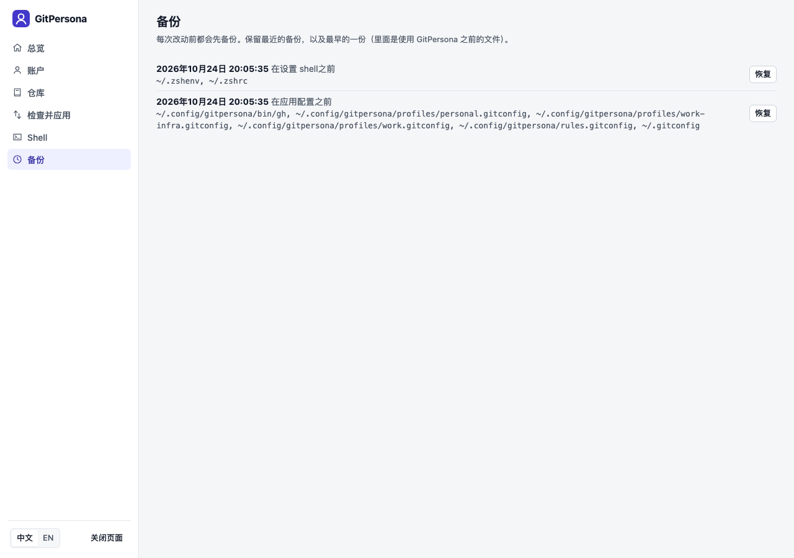
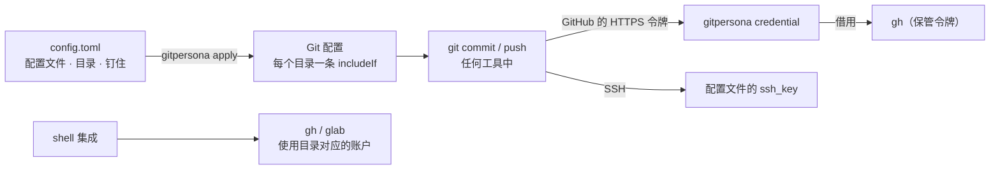

# GitPersona

[English](README.md) | **简体中文**

[](https://github.com/weikxs/gitpersona/actions/workflows/ci.yml)
[](https://github.com/weikxs/gitpersona/releases)
[](go.mod)
[](LICENSE)
[](#支持的系统)
[](#网页控制台)

**跟着目录自动切换的 Git 身份。**

在 `~/Projects/acme` 里，你用公司账户提交、推送、开 PR；
换到 `~/Projects/personal`，你又自动变回个人账户。不用执行任何命令，也不用记着切换，
还能逐个仓库核对，确认没有一个仓库会用错账户提交或推送。

<picture>
  <source media="(prefers-color-scheme: dark)" srcset="docs/images/terminal-dark.png">
  
</picture>

> **状态：第一个正式版本（0.1）。** 下面的功能都已可用，并在 macOS 和 Linux 上测试：GitHub、GitLab、Bitbucket 及其他主机的
> 配置文件、命令行、中英双语的网页控制台、shell 集成和 `gh` / `glab` 切换。Windows 在计划中。欢迎反馈和提交 issue。

## 目录

- [三步上手](#三步上手)
- [网页控制台](#网页控制台)
- [命令行](#命令行)
- [为什么需要](#为什么需要)
- [功能](#功能)
- [工作原理](#工作原理)
- [支持的系统](#支持的系统)
- [安装](#安装)
- [快速上手](#快速上手)
- [配置参考](#配置参考)
- [命令](#命令)
- [行为说明](#行为说明)
- [撤销与卸载](#撤销与卸载)
- [故障排查](#故障排查)
- [常见问题](#常见问题)
- [参与贡献](#参与贡献) · [安全](#安全) · [许可证](#许可证)

## 三步上手

**1. 安装**（macOS：Apple 芯片和 Intel 都支持；以及 Linux）：

```sh
curl -fsSL https://raw.githubusercontent.com/weikxs/gitpersona/main/install.sh | sh   # macOS 和 Linux，全自动安装
brew install weikxs/tap/gitpersona          # 或者用 Homebrew
```

**2. 在浏览器里完成配置。** 先用 `gh auth login` 把每个 GitHub 账户登录一次，然后运行：

```sh
gitpersona setup --web
```

GitPersona 会找出你的账户、已有的 `includeIf` 身份、SSH 别名和仓库，给出一份完整的方案。
点"应用"之前不会写入任何文件，写入前所有文件都会先备份。习惯用终端？`gitpersona setup` 会在终端里给出同样的方案，只问一次。

<picture>
  <source media="(prefers-color-scheme: dark)" srcset="docs/images/setup-zh-dark.png">
  
</picture>

**3. 逐个核对仓库。** `gitpersona verify`（或 `gitpersona ui` 里的"仓库"页面）列出每个仓库提交用的作者、
每个远程推送用的账户，凡是会用错身份的都会标出来。加上 `--ssh`，还会让每个 SSH 主机报出密钥实际登录的账户。

**日常使用什么都不用做：** 进入项目目录，照常使用 `git`、`gh` 或 IDE。
想确认当前身份就运行 `gitpersona whoami`；新目录用 `gitpersona use <profile>` 指定身份；
放在别处的个别仓库用 `gitpersona pin <profile>`。

## 网页控制台

`gitpersona ui` 会在浏览器里打开一个本地控制台（只监听 127.0.0.1；链接只能用一次，关闭标签页大约 10 秒后，或 15 分钟不用，会自动停止）。
命令行能做的事这里都能做，并且中英双语：默认跟随系统语言，其次是浏览器语言，都不是中英文时显示英文；
侧栏底部的开关可以切换当前页面的语言。

**总览：** 关键数字（账户、仓库、串号、需留意、体检），需要处理的事放在最前面，
下面的表格列出每个账户、它的各个身份以及各自管的目录。

<picture>
  <source media="(prefers-color-scheme: dark)" srcset="docs/images/overview-zh-dark.png">
  
</picture>

**账户：** 每个账户一张卡片。用不同作者名提交的账户，下面会有多个身份，各自列出目录和钉住的仓库；
目录和钉住都可以直接在这里添加、删除。

<picture>
  <source media="(prefers-color-scheme: dark)" srcset="docs/images/accounts-zh-dark.png">
  
</picture>

**仓库：** 按账户分组，列出每个仓库由谁提交、由谁推送，可以筛选，每条说明或问题都写明原因。

<picture>
  <source media="(prefers-color-scheme: dark)" srcset="docs/images/repositories-zh-dark.png">
  
</picture>

**检查并应用：** 写入任何文件之前，先以差异（diff）形式列出每个要改动的文件。

<picture>
  <source media="(prefers-color-scheme: dark)" srcset="docs/images/apply-zh-dark.png">
  
</picture>

<details>
<summary><b>更多页面：</b>体检、Shell、备份</summary>

**体检**（在总览页底部）：与 `gitpersona doctor` 相同的检查，每一项都写明该怎么处理。

<picture>
  <source media="(prefers-color-scheme: dark)" srcset="docs/images/health-zh-dark.png">
  
</picture>

**Shell：** 你的登录 shell、当前运行的 shell，以及哪些已安装的 shell 加载了 GitPersona。

<picture>
  <source media="(prefers-color-scheme: dark)" srcset="docs/images/shells-zh-dark.png">
  
</picture>

**备份：** 每次改动前都会先备份，可以恢复任意一份（恢复前也会备份当前状态）。

<picture>
  <source media="(prefers-color-scheme: dark)" srcset="docs/images/backups-zh-dark.png">
  
</picture>

</details>

手机屏幕和系统深色模式都能正常显示。本文中的图片由 `make screenshots` 在一个演示用的主目录里生成，账户均为虚构。

## 命令行

控制台里能看到的内容，命令行里都有，方便写脚本，也适合习惯终端的人。命令行输出为英文。

**`gitpersona setup`** 查看你已有的设置，提出一份完整方案；在你确认之前不会写入任何内容。

<picture>
  <source media="(prefers-color-scheme: dark)" srcset="docs/images/terminal-setup-dark.png">
  
</picture>

**`gitpersona verify`** 逐个仓库列出作者和推送账户，说明哪里不对、怎么修。只要有仓库会用错身份提交或推送，
它就以错误状态退出，可以直接放进脚本和 CI。

<picture>
  <source media="(prefers-color-scheme: dark)" srcset="docs/images/terminal-verify-dark.png">
  
</picture>

**`gitpersona doctor`** 检查整个配置，从 Git 版本到每个账户的 `gh` 登录状态。

<picture>
  <source media="(prefers-color-scheme: dark)" srcset="docs/images/terminal-doctor-dark.png">
  
</picture>

## 为什么需要

很多开发者在同一台电脑上用多个 Git 账户：个人、公司、客户。
Git、`gh`、`glab` 都假定只有一个全局的"当前账户"，于是很容易用错邮箱提交、用错令牌推送，或者用错账户开 PR。

## 功能

- **一个目录，一个身份。** 把目录绑定到一个配置文件（Profile），里面所有仓库都跟着用这个身份。
- **一套规则管全部：** 提交作者和邮箱、HTTPS 凭据、SSH 密钥、提交签名，以及 `gh` / `glab` 账户。
- **同一主机多个账户。** 两个 GitHub 账户、公司服务器上的三个 GitLab 账户：每个目录都用自己账户的令牌推送。
- **有据可查，不靠猜。** `gitpersona verify` 逐个核对仓库的作者和推送账户是否与配置文件一致，
  能发现写在远程地址里的令牌、不同密钥共用的 SSH 连接，还可以让每个 SSH 主机报出密钥实际登录的账户。
- **到处都生效：** fish、zsh、bash，IDE 和图形化 Git 客户端，脚本和非交互式 shell。
  借助 Git 自带的 `includeIf`，而不是改写你的全局配置。
- **从不保存令牌，从不读取密钥。** 凭据始终留在 `gh`、系统钥匙串（或 Git Credential Manager）和 ssh-agent 里。
  私钥文件只检查是否存在。
- **一分钟完成配置。** `gitpersona setup` 会找到你已登录的账户、已有的 `includeIf` 身份、SSH 别名和仓库，
  提出一份完整的配置，你只需确认一次。
- **中英双语的网页控制台：** 总览、账户、仓库、检查并应用、Shell、备份，全都可以在浏览器里完成。
- **仓库钉住（Repo Pin）：** 给放在常规目录之外的个别仓库单独指定身份。
- **放心试用。** 每次改动都会备份；`rollback` 和 `uninstall` 能把你的文件原样恢复。

```text
~/Projects/personal/**       → octo-alex    （个人，GitHub）
~/Projects/acme/**           → acme-alex    （工作，GitHub）
~/Projects/clients/globex/** → globex-alex  （客户，自建 GitLab）
其他所有地方                  → acme-alex    （默认）
```

## 工作原理



涉及的文件：

```text
~/.config/gitpersona/config.toml        你的配置文件、目录和钉住（手动编辑，或由 setup / ui 生成）
            │  gitpersona apply
            ▼
~/.gitconfig                            末尾一个带标记的区块，引入 ↓
~/.config/gitpersona/rules.gitconfig    includeIf "gitdir:<目录>/" → profiles/<id>.gitconfig，越具体越靠后
~/.config/gitpersona/profiles/*.gitconfig
                                        user.name / user.email、凭据账户、core.sshCommand、签名
```

由 Git 自己根据仓库所在位置选择配置文件，所以凡是调用 Git 的工具都生效。对 GitHub，Git 向
`gitpersona credential` 要令牌，它借用 `gh` 为该账户保存的令牌。对其他主机，配置文件只指明账户，
由你自己的凭据助手返回该账户的令牌。启用 shell 集成后，`gh` 和 `glab` 也遵循同样的规则。

## 支持的系统

| 系统 | 芯片 | 状态 |
|---|---|---|
| macOS 12 Monterey 或更新版本 | Apple 芯片（M1 及以后） | 支持，每次发布前测试 |
| macOS 12 Monterey 或更新版本 | Intel | 支持，每次发布前测试 |
| Linux：Debian、Ubuntu、Fedora、Arch、Alpine 等（glibc 或 musl） | x86_64、arm64 | 支持，每次改动都测试 |
| Windows | — | 计划中 |

每个 PR 都会在 Linux x86_64 上运行测试；每次发布前还会在 Apple 芯片和 Intel 芯片的 Mac 以及 Linux arm64 上运行。

**系统要求**

- Git 2.31 或更新版本。如果你自己写了 `includeIf "hasconfig:remote.*.url:…"` 规则，需要 Git 2.36 或更新版本：
  更旧的 Git 会忽略这类规则，`gitpersona doctor` 会提示。
- GitHub 配置文件需要 [GitHub CLI](https://cli.github.com) 2.40 或更新版本，并登录每个账户
- GitLab、Bitbucket 及其他主机需要一个按账户保存令牌的凭据助手，例如系统钥匙串（macOS 上的 `osxkeychain`、
  Linux 上的 `libsecret`）或 [Git Credential Manager](https://github.com/git-ecosystem/git-credential-manager)；
  `gitpersona doctor` 会推荐一个已安装的
- 可选：GitLab 用的 [`glab`](https://gitlab.com/gitlab-org/cli)；shell 集成需要 fish、zsh 或 bash

## 安装

### 安装脚本（macOS 和 Linux，推荐）

一条命令，全自动完成。Mac（Apple 芯片或 Intel）和 Linux（x86_64 或 arm64，glibc 或 musl：Debian、Ubuntu、Fedora、
Arch、Alpine 等）用法完全相同：

```sh
curl -fsSL https://raw.githubusercontent.com/weikxs/gitpersona/main/install.sh | sh
```

没有 `curl` 的话用：`wget -qO- https://raw.githubusercontent.com/weikxs/gitpersona/main/install.sh | sh`

脚本会依次完成：

1. 识别系统（macOS 或 Linux）和 CPU（x86_64 或 arm64；Apple 芯片的 Mac 即使在 Rosetta 终端里运行，也会安装原生版本）。
2. 找到最新的 Release，从 GitHub 下载对应的压缩包。
3. 用 Release 里的 `checksums.txt`（SHA-256）校验压缩包；校验不通过就停止，什么都不安装。
4. 把 `gitpersona` 安装到 `~/.local/bin`（以 root 运行时装到 `/usr/local/bin`），已有旧版本时直接替换。
   在 macOS 上会去掉隔离标记，系统不会拦截这个未经 Apple 签名的程序。
5. 如果这个目录不在 `PATH` 里，就在 shell 启动文件中加一行（`~/.zshrc`；Linux 上是 `~/.bashrc`，macOS 上是
   `~/.bash_profile`；fish 的 `conf.d`；或 `~/.profile`），只加一次，带有标记注释。
6. 运行 `gitpersona version`，确认程序能正常运行。

**Mac 上的完整步骤：**

1. 打开“终端”（Terminal），粘贴上面的 `curl` 命令，回车。
2. 看到 `installed gitpersona …` 和 `done` 就表示装好了。
3. 关掉终端再重新打开（让 PATH 生效），然后继续：

```sh
gitpersona version
gh auth login          # 每个 GitHub 账户登录一次
gitpersona setup --web
```

**Linux 上的完整步骤：** 和 Mac 一样，在终端里运行同一条 `curl` 命令（没有 curl 就用 `wget` 那条），
重新打开终端后运行上面三条命令。普通用户装在 `~/.local/bin`，不需要 `sudo`。

需要选项时写在 `sh -s --` 后面：

```sh
curl -fsSL https://raw.githubusercontent.com/weikxs/gitpersona/main/install.sh | sh -s -- --version v0.1.0      # 安装指定版本
curl -fsSL https://raw.githubusercontent.com/weikxs/gitpersona/main/install.sh | sh -s -- --dir ~/bin           # 装到其他目录
curl -fsSL https://raw.githubusercontent.com/weikxs/gitpersona/main/install.sh | sh -s -- --no-modify-path      # 不改 shell 启动文件
```

升级：再运行一次同一条命令。想先看脚本内容再执行：
`curl -fsSL https://raw.githubusercontent.com/weikxs/gitpersona/main/install.sh -o install.sh && less install.sh && sh install.sh`。
脚本只需要 `sh`、`curl` 或 `wget`、`tar`，以及 `sha256sum` 或 `shasum`，Mac 和 Linux 都自带；脚本不会使用 `sudo`。

### 其他安装方式

**用 Go 安装**（1.26 或更新版本）：

```sh
go install github.com/weikxs/gitpersona/cmd/gitpersona@latest
```

**从源码构建：**

```sh
git clone https://github.com/weikxs/gitpersona.git
cd gitpersona
make build
./bin/gitpersona version   # 然后把 bin/gitpersona 放到 PATH 里
```

**Homebrew**（macOS 和 Linux）：

```sh
brew install weikxs/tap/gitpersona
```

程序没有经过 Apple 签名和公证，今后也不打算签名，所以在 macOS 上 Cask 安装后会去掉系统给它加的隔离标记，详见
[SECURITY.md](SECURITY.md#release-binaries-and-macos)。
Homebrew 会自动选择适合你的 Mac 的版本（Apple 芯片或 Intel）。

**Linux 安装包**可以从 [Release 页面](https://github.com/weikxs/gitpersona/releases)下载，
提供 x86_64（`amd64`）和 arm64 两种：

```sh
sudo apt install ./gitpersona_<版本>_linux_amd64.deb   # Debian、Ubuntu
sudo dnf install ./gitpersona_<版本>_linux_amd64.rpm   # Fedora、RHEL
```

各平台的压缩包（`.tar.gz`）也在那里，并附有用于校验的 `checksums.txt`。Alpine、Arch 等其他系统请用上面的安装脚本或压缩包：
程序除了 Git 没有其他依赖。

## 快速上手

### GitHub 账户

1. 用 GitHub CLI 登录每个 GitHub 账户：`gh auth login`（每个账户一次）。
2. 运行 `gitpersona setup`（或者 `gitpersona setup --web`，在浏览器里完成同样的事）。它会查看你已有的东西，一步整理好：
   - 每个在 `gh` 登录的账户一个配置文件，带上它公开的名字和邮箱（没有公开邮箱就用 noreply 地址）；
   - 你已有的 `includeIf` 身份，连同 SSH 密钥和签名，由配置文件接管（同时还设置了其他内容的规则，例如
     `url.*.insteadOf`，会保留）；
   - 根据常用代码目录（`~/code`、`~/Projects` 等）里仓库的远程地址和邮箱推断出的目录；
   - `~/.ssh/config` 里的 SSH 主机别名（例如 `git@github-work:…`）及其密钥（密钥文件从不打开）；
   - 与所在目录不一致的仓库的钉住，以及登录 shell 的集成。

   它会展示结果并只问一次；动手前会先备份所有文件。无法判断归属的组织目录会列出来让你选择。
   在浏览器里，"Adjust step by step（逐步调整）"可以在应用前修改任何内容。
3. 运行 `gitpersona doctor`。在任何仓库里，`gitpersona whoami` 都会告诉你当前是谁、为什么。

### GitLab、Bitbucket 及其他主机

即使没有 `gh`，`gitpersona setup` 也会把你已有的 GitLab、Bitbucket 或公司服务器身份变成配置文件：
`includeIf` 文件里写明了账户（`credential.https://<主机>.username`）的，或者其仓库都以同一用户推送到同一台这类主机的。
也可以手动添加配置文件（见下文）。然后在你自己的凭据存储里为每个账户保存一次令牌：

```sh
git config --global credential.helper osxkeychain   # 如果你还没有凭据助手（Linux 上用 libsecret）
gitpersona auth login --profile globex               # 粘贴个人访问令牌；输入不回显
gitpersona auth status                                # 查看哪些配置文件已有令牌
```

之后在该配置文件的目录里推送，就会用这个账户，`glab` 也一样。

### 自己编写配置

`~/.config/gitpersona/config.toml`：

```toml
version = 1
default = "acme"            # 没有规则匹配时使用（可选）

[[profile]]
id      = "personal"
account = "octo-alex"       # 你在该主机上的账户
name    = "Alex Octo"       # 提交作者名
email   = "1000001+octo-alex@users.noreply.github.com"
dirs    = ["~/Projects/personal"]
signing = { method = "ssh", key = "~/.ssh/id_personal.pub" }

[[profile]]
id      = "acme"
account = "acme-alex"
name    = "Alex (Acme)"
email   = "1000002+acme-alex@users.noreply.github.com"
dirs    = ["~/Projects/acme"]
ssh_key = "~/.ssh/id_acme"

[[profile]]
id       = "globex"
provider = "gitlab"
host     = "gitlab.globex.example"
account  = "globex-alex"
name     = "Alex"
email    = "alex@globex.example"
dirs     = ["~/Projects/clients/globex"]

[[pin]]
repo    = "~/Downloads/globex-hotfix"
profile = "globex"
```

然后运行 `gitpersona apply` 和 `gitpersona doctor`。`gitpersona ui` 可以在浏览器里打开同一份配置。

## 配置参考

| 键 | 必填 | 含义 |
|---|---|---|
| `version` | 是 | 固定为 `1` |
| `default` | 否 | 没有规则或钉住匹配时使用的配置文件 id |
| `shell_integration` | 否 | 设为 `false` 表示你不想在 shell 中加载 GitPersona，`doctor` 不再建议安装（`setup --no-shell` 会写入它） |
| `[[profile]] id` | 是 | 简短名称：小写字母、数字、`-` |
| `provider` | 否 | `github`（默认）、`gitlab`、`bitbucket` 或 `generic`；后三者的令牌存放在你自己的凭据存储里，每个账户一个（`gitpersona auth login`） |
| `host` | 否 | GitHub 默认为 `github.com`；其他提供方必填（可以带端口，例如 `git.example.com:8443`） |
| `account`、`name`、`email` | 是 | 主机上的账户、提交作者名和邮箱 |
| `dirs` | 否 | 使用该配置文件的仓库所在目录；最具体的目录优先 |
| `ssh_key` | 否 | 该配置文件让 Git 使用的 SSH 私钥路径（只检查是否存在，从不读取） |
| `signing` | 否 | `{ method = "ssh", key = "~/.ssh/key.pub" }`、`{ method = "gpg", key = "<key id>" }` 或 `{ method = "none" }` |
| `[[pin]] repo`、`profile` | — | 把单个仓库绑定到某个配置文件，优先于目录规则 |

路径必须是绝对路径或以 `~/` 开头。

## 命令

| 命令 | 作用 |
|---|---|
| `gitpersona setup [--yes] [--no-shell] [--keep-old-rules] [--default <profile> \| --no-default] [--print \| --web]` | 根据你已有的东西一步完成设置（账户、已有身份、仓库、SSH 别名、shell）；除非加 `--yes`，写入前会先询问；`--web` 在浏览器里展示，也可以逐步调整 |
| `gitpersona ui [--no-open]` | 在浏览器里打开中英双语的网页控制台：总览、账户及其身份、目录和钉住、仓库核对、应用前的差异预览、体检、shell 和备份。只监听 127.0.0.1，链接只能用一次，关闭标签页后不久或闲置 15 分钟后自动退出 |
| `gitpersona apply [--dry-run] [--yes]` | 生成 Git 配置；`--dry-run` 只预览，`--yes` 允许删除已删除配置文件对应的文件 |
| `gitpersona whoami [--json] [--check]` | 显示此处 Git 使用哪个配置文件及原因；`--check` 在 Git 实际结果不一致时报错 |
| `gitpersona verify [--all] [--ssh] [--json] [<目录>...]` | 逐个核对配置文件目录和钉住的仓库（以及你指定的目录）：提交用的作者、每个远程推送用的账户，是否与配置文件一致；标出用错身份、远程地址里写有令牌、不同密钥共用 SSH 连接等问题。只读取配置；`--ssh` 会像推送一样登录每个 SSH 主机一次，由主机报出账户 |
| `gitpersona use <profile>` | 让当前目录使用某个配置文件（保留 config.toml 里的注释） |
| `gitpersona remove [dir]` | 不再把某个目录分配给配置文件 |
| `gitpersona pin <profile>` / `unpin` | 把当前仓库绑定到某个配置文件，或取消钉住 |
| `gitpersona list [--json]` | 列出配置文件、目录和钉住 |
| `gitpersona doctor [--fix] [--json]` | 检查设置并说明如何修复；`--fix` 自动修复能安全修复的问题 |
| `gitpersona auth login\|logout\|status [--profile <id>]` | 在你自己的凭据存储（系统钥匙串或 Git Credential Manager）里为 GitLab、Bitbucket 等配置文件保存、删除或检查令牌，每个账户一个；缺令牌时 `status` 返回失败 |
| `gitpersona check-ssh [--profile <id>]` | 用每个配置文件的 SSH 密钥连接它的主机，报告主机认出的账户；只在你主动运行时执行，GitPersona 不打开密钥（由 ssh 使用） |
| `gitpersona shells [--json]` | 显示你的默认 shell、当前正在用的 shell，以及已安装的 shell |
| `gitpersona install-shell [--shell fish,zsh,bash]` | 为 shell 加上提示符显示（以及 gh / glab 切换）；默认只装你的登录 shell |
| `gitpersona prompt [--format]` | 输出此处 Git 使用的账户，供提示符使用（`{account}`、`{profile}`、`{host}`） |
| `gitpersona rollback [<name>\|latest] [--yes]` | 列出备份，或恢复其中一个（恢复前会先备份当前状态） |
| `gitpersona uninstall [--yes]` | 从 Git 配置中移除 GitPersona，并放回它接管的 `includeIf` 规则；保留 config.toml |
| `gitpersona help <command>` | 显示某个命令的参数 |

提示符和插件管理器（tide、Powerlevel10k、Starship、fisher、oh-my-zsh）的配置见 [docs/integrations.md](docs/integrations.md)。

## 行为说明

- **优先级：** 先看钉住，再看最具体的目录规则，最后是 `default`。Git 按仓库 `.git` 目录的位置应用规则，
  所以 **worktree 跟随它的主仓库**。在任何仓库之外只有 `default` 生效；`whoami` 也会告诉你新克隆的仓库会用哪个配置文件。
- **你自己的 `includeIf` 规则：** GitPersona 的规则排在你的规则之后，所以在你分配给配置文件的目录（以及钉住的仓库）里由配置文件决定；
  其他地方你自己的规则照常生效。默认配置文件在所有地方都生效，所以只要你还保留着自己的身份规则，`setup` 就不会提议默认配置文件
  （`--default <profile>` 仍可以设置，并会说明它覆盖了你的哪些规则）。做了配置文件做不到的事的规则——x509 签名、带端口或代理的 SSH 命令、
  只用于标签的密钥，不论是否带身份——会保留它们的目录，包含它们的上层目录也一样。今天本来就不生效的规则（被你后面的规则或全局身份覆盖，
  按 Git 读取 `~/.config/git/config`、`~/.gitconfig` 及其包含文件的顺序）不受保护。配置文件只在别的身份的密钥可能影响到它们的地方
  重置签名和 SSH 命令。属于另一个已登录账户的仓库会被钉到该账户，从而用该账户推送。`setup` 会移除被配置文件完全接管的规则；
  `uninstall` 会把它们放回原来后面那一节（或那条规则）之前。`doctor` 会说明你的哪些规则被配置文件覆盖。
- **凭据：** 对 GitHub 配置文件，GitPersona 是该主机唯一的凭据助手，借用 `gh` 已保存的令牌，因此不会有其他助手另存一份。
  如果某个账户没有在 `gh` 登录，Git 会要求输入密码；`gitpersona doctor` 会告诉你该登录哪个账户。对 GitLab、Bitbucket 等主机，
  像 `gh` 对 GitHub 那样，由你自己的凭据助手（系统钥匙串、Git Credential Manager）按"主机 + 账户"各保存一个令牌：
  `gitpersona auth login` 把令牌存进去（输入不回显，绝不写入明文文件），每个配置文件只指定账户名，由对应的令牌应答。
  GitPersona 不保存任何副本。凭据助手请为整台主机（或全局）设置：只为 `https://<用户>@主机` 设置的助手，Git 只在远程地址里
  写了该用户时才会用。这些主机请不要开启 `credential.useHttpPath`：开启后助手按仓库而不是按账户保存令牌。
- **gh 和 glab 也跟着目录走：** 装上 shell 集成后，在某个配置文件的目录里运行 `gh` 就会用该配置文件的账户。GitPersona 只把该账户的
  令牌放进那一次 `gh` 进程的环境变量里，不会打印也不会保存。如果你设置了 `GH_TOKEN`/`GITHUB_TOKEN`、用 `GH_HOST` 指向其他主机，
  或者没有 GitHub 配置文件生效，它就不干预 `gh`。`glab` 也一样：在 GitLab 配置文件的目录里，它用你凭据存储里该账户的令牌
  （`GITLAB_TOKEN`，只放进那一次进程），除非你自己设置了令牌或其他主机。
- **SSH：** 设置了 `ssh_key` 的配置文件，会让 Git 在它的仓库里只用这把密钥连接
  （`ssh -i <密钥> -o IdentitiesOnly=yes -o ControlPath=none`）：只提供这一把密钥，也绝不复用用别的密钥建立的共享连接
  （`~/.ssh/config` 中的 `ControlMaster`），否则会以那把密钥的账户推送。对没有配置密钥的仓库，如果共享连接仍可能混用账户，
  `gitpersona verify` 会给出警告。`gitpersona check-ssh` 和 `gitpersona verify --ssh` 只在你运行时用每把密钥连接一次，
  报告主机欢迎语里的账户；除此之外不会有任何操作启动 ssh。
- **Shell：** 默认 shell 从系统用户记录中读取（而不是 `$SHELL`，终端、IDE 和各种工具经常会改它），当前正在用的 shell
  从进程树中判断，已安装的 shell 从 `/etc/shells` 读取。fish 使用 `conf.d` 中单独的文件；zsh 使用 `$ZDOTDIR`（未设置时为 `~`）中的 `.zshenv` 和
  `.zshrc`；bash 使用 `~/.bashrc`。
  tide 中添加 `gitpersona` 项；Powerlevel10k 中添加 `gitpersona` 段；其他情况调用 `gitpersona_prompt`。
- **隐私：** GitPersona 从不打开、读取、列出或使用你的私钥，也从不打印或保存令牌。它唯一的联网行为是 setup 时向 `gh`
  查询账户公开的名字和邮箱，以及你运行 `check-ssh`、`verify --ssh` 时发起的 ssh 连接。不加 `--ssh` 的 `verify`
  只读取 Git 和 SSH 设置。路径都以 `~` 显示；网页控制台只监听 127.0.0.1，并通过一次性链接访问。
- **你的文件：** 它只在全局 Git 配置中添加一个带标记的区块（会跟随符号链接的 `~/.gitconfig` 和 `GIT_CONFIG_GLOBAL`），
  改动前备份所有被修改的文件，并在 `~/.config/gitpersona/backups/` 中保留最新的 20 份备份，另外始终保留第一份备份，
  以及所有记录了被接管的 `includeIf` 规则的备份，这样 `gitpersona uninstall` 总能把这些规则放回去。

## 撤销与卸载

- `gitpersona rollback` 列出备份；`gitpersona rollback latest` 撤销最近一次改动。每条命令的改动是一份备份，
  所以一次回滚会撤销整个操作。
- `gitpersona uninstall` 从你的 Git 配置中移除 GitPersona 的区块，并把 setup 接管的 `includeIf` 规则原样放回。
  `config.toml` 会保留，运行 `gitpersona apply` 即可恢复一切。
- 要彻底删除：运行 `gitpersona uninstall`（它也会删掉 `install-shell` 加的 shell 设置），然后删掉 `install.sh`
  为了把程序加入 PATH 而加的两行：`# Added by the GitPersona installer` 这一行和它后面的 `export PATH=…` 行，位于
  `.zshrc`（在 `$ZDOTDIR` 或 `~` 中）、`~/.bashrc`（Linux）、`~/.bash_profile`（macOS）或 `~/.profile` 中；fish 则删除
  `~/.config/fish/conf.d/gitpersona-path.fish`。如果你是手动或用 fisher 设置的 shell，也要删掉那些行或
  `~/.config/fish/conf.d/gitpersona.fish`。最后删除 `~/.config/gitpersona` 和程序本身（用 `install.sh` 安装的在
  `~/.local/bin/gitpersona`）。

## 故障排查

| 现象 | 原因与处理 |
|---|---|
| `doctor`：某个账户没有登录 `gh` | 为该账户运行一次 `gh auth login`；GitPersona 借用 `gh` 保管的令牌 |
| `verify`：提交用了别的作者 | 仓库自己设置了 `user.name` / `user.email`；用 `git config --local --unset user.email` 删除（verify 会打印准确的命令） |
| `verify`：远程以别的账户推送 | 仓库自己设置了 `credential.username`，或远程地址里写了用户名；删除该设置，或用 `gitpersona pin` 把仓库钉到它所属的配置文件 |
| `verify`：远程地址里写着令牌 | 能读到 `.git/config` 的人都能用它。改成不含令牌的地址：`git remote set-url origin https://github.com/<owner>/<repo>.git`，然后吊销该令牌 |
| `verify`：SSH 推送"待确认" | ssh 提供的密钥没有写在你的设置里（ssh-agent 或默认密钥）。给配置文件设置 `ssh_key`，或运行 `gitpersona verify --ssh` 让主机报出账户 |
| `verify`：不同密钥共用了 SSH 连接 | `~/.ssh/config` 中的 `ControlMaster` 会复用别的密钥建立的连接。设置了 `ssh_key` 的配置文件已自动跳过；其他情况请为该主机设置 `ControlPath none` |
| `doctor`：`includeIf "hasconfig:…"` 规则从不生效 | 你的 Git 低于 2.36，会忽略这类规则；请升级 Git |
| 终端里的 `gh` 用错了账户 | 没有安装 shell 集成，或 `PATH` 中有别的目录排在它前面：运行 `gitpersona install-shell`，然后打开新终端 |
| 在 GitLab 等主机上 Git 要求输入密码 | 该账户还没有令牌：`gitpersona auth login --profile <id>` |
| macOS 提示无法验证该程序，或"已损坏" | 程序没有 Apple 签名，今后也不会签名；Homebrew 和安装脚本会移除隔离标记。手动安装的程序可运行：`xattr -d com.apple.quarantine "$(command -v gitpersona)"`，或在"系统设置 → 隐私与安全性"里点"仍要打开"（[SECURITY.md](SECURITY.md#release-binaries-and-macos)） |

`gitpersona doctor --json` 和 `gitpersona verify --json` 以 JSON 输出同样的结果，便于脚本处理。

## 常见问题

**它会改动我现有的 Git 设置吗？** 只会添加那个带标记的区块。在你分配给配置文件的目录之外，你自己的 `includeIf` 规则照常生效；
`setup` 会展示它要做的所有改动并先询问你，每次改动都会备份。

**在 IDE 或图形化客户端里也有效吗？** 有效。规则就是普通的 Git 配置，所以任何调用 Git 的程序都会遵守。只有 `gh` / `glab`
切换需要 shell 集成。

**我的令牌在哪里？** GitHub 的令牌留在 `gh` 里；其他主机的令牌留在你的凭据存储里。GitPersona 不保存副本，也从不打印。

**为什么 `doctor` 对我的凭据助手发出警告？** 对 GitLab、Bitbucket 等主机，凭据助手必须按账户保存令牌：`store` 会把令牌
明文写进文件，`cache` 会过一段时间忘掉，`credential.useHttpPath` 会按仓库保存。`doctor` 会告诉你该改什么。

**支持哪些语言？** 网页控制台支持英文和简体中文：默认跟随系统语言，其次是浏览器语言，都不是时显示英文。命令行为英文。

**支持 Windows 吗？** 暂不支持；macOS（Apple 芯片和 Intel）和 Linux 已支持，并且每次改动都会测试。Windows 在计划中。

**worktree 和子模块呢？** worktree 跟随它的主仓库，子模块跟随它所属的仓库，因为 Git 按 `.git` 目录所在的位置匹配规则。

## 参与贡献

欢迎贡献。请先阅读 [CONTRIBUTING.md](CONTRIBUTING.md) 和[开发规范](docs/development/standards.md)。

```sh
make check         # 格式检查、vet、隐私检查和全部测试（覆盖率不低于 95%）
make lint          # golangci-lint
make e2e           # 在无头 Chrome 中测试网页控制台
make screenshots   # 在演示主目录中重新生成 docs/images 里的图片
```

每个版本的改动见 [CHANGELOG.md](CHANGELOG.md)；设计文档见 [docs/prd](docs/prd/README.md)。

## 安全

请私下报告安全漏洞，详见 [SECURITY.md](SECURITY.md)。

## 许可证

[MIT](LICENSE)
